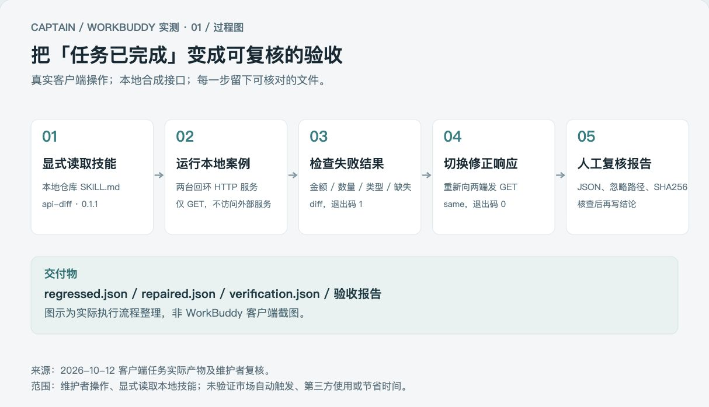
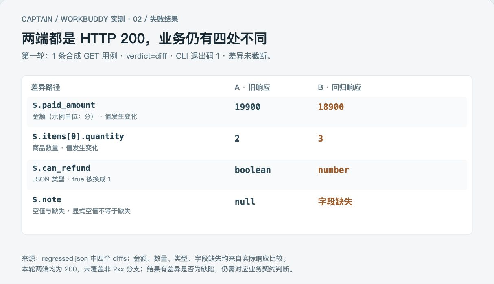
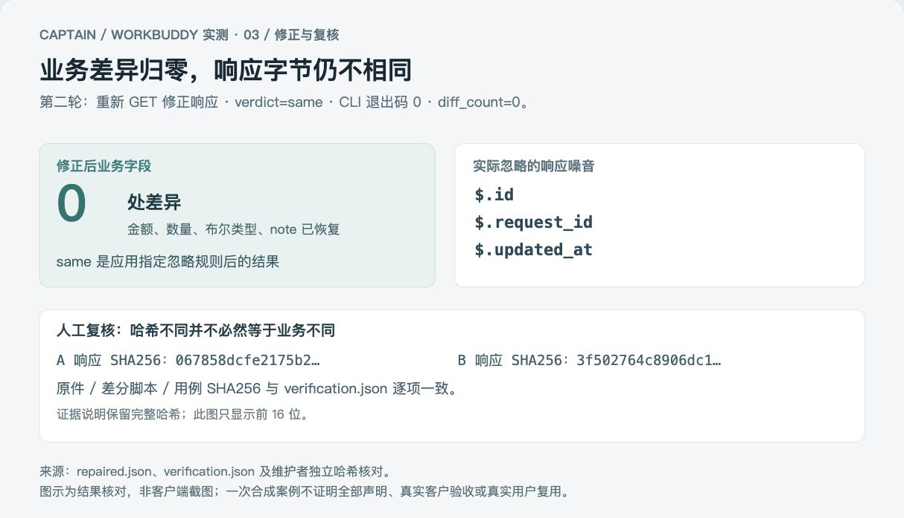

# 【征文】我用 WorkBuddy 给自己的接口差分技能做一次验收

作者：Captain。实测日期：2026-10-12。本文已准备公开，尚未向征文活动投递。

两套接口都返回 HTTP 200，金额、数量、字段类型却可能不同。做接口迁移验收时，只检查“请求成功”还不够。我想验证的是：WorkBuddy 能否读取我写的接口差分技能，实际运行一次“发现回归 → 修正复验”，再留下可以核对的结果。

这次我在 WorkBuddy 5.5.6 客户端中，使用界面标注的 Space-Bunny 模型创建并运行任务。执行方式是**显式读取本地仓库中的 `SKILL.md`**；对象是我自己的 `api-diff` 0.1.1。输入为公开合成订单，两端都是示例自行建立的回环 HTTP 服务。它不是客户生产案例，也不是第三方用户试用。

本文三张图由实际产物整理，是流程图和结果图，**不是客户端截图**。本次客户端截图捕捉失败，因此没有把绘图或重建界面充作操作截图。

## 先把任务说清楚

我给 WorkBuddy 的首次任务如下，仅将个人仓库路径替换为占位符：

> 请使用 `<仓库路径>` 中的公开接口差分技能完成一次升级验收。先读取 `skills/api-diff/SKILL.md` 和 `examples/local-order-acceptance.md`，然后运行 `python3 skills/api-diff/examples/local_order_demo.py --out out/workbuddy-client-api-20261012`。只访问示例自建的回环 HTTP 服务，不安装依赖、不改源码、不读取其他目录或凭据。核对 `regressed.json` 有金额、数量、布尔类型、缺失字段四处差异且退出 1，修正后 `repaired.json` 为 same 且退出 0；保留实际忽略路径及输入 SHA256。用实际产物写出验收结论，不把合成案例说成真实客户成果。

这里的 `examples/local-order-acceptance.md` 指技能目录中的[本地案例说明](../../skills/api-diff/examples/local-order-acceptance.md)。复现时在仓库根目录运行；输出目录需是新建或空目录，已有结果不会被覆盖。

这样约束任务，是为了先回答一个小而明确的问题：它有没有执行声明的步骤，输出有没有支持结论。先不接真实外部接口，也不修改业务代码。



*图1：按本次实际执行整理的流程图，非客户端截图。*

## 第一轮：200 响应里找出四处不同

示例先让两台本地服务分别返回旧响应和回归响应，再对同一条订单执行 GET。WorkBuddy 运行后生成了差分 JSON、可读报告和验证文件。

第一轮输出 `verdict: diff`，差分工具退出码为 1。实际 JSON 中有四处差异，且没有被截断：

| 路径 | 旧响应 | 回归响应 | 为什么要核对 |
|---|---|---|---|
| `$.paid_amount` | 19900 | 18900 | 实付金额发生变化，示例单位为分 |
| `$.items[0].quantity` | 2 | 3 | 商品数量发生变化 |
| `$.can_refund` | boolean | number | `true` 被换成了 `1`，值看似接近但 JSON 类型不同 |
| `$.note` | `null` | 字段缺失 | 显式空值与没有这个字段不同 |

两端都返回了 HTTP 200。这只能说明请求得到了成功响应，不能代替业务字段比较。四处差异是否都属于缺陷，最终仍要按接口契约判断；在这个合成案例里，它们是我预先放入的回归。



*图2：从 `regressed.json` 绘制的四处差异，非客户端截图。*

## 第二轮：修正后再请求一次

接下来，**演示脚本将新端切换为事先准备好的修正响应**，重新向两端发起 GET。这里没有让 WorkBuddy 修改真实服务，也没有把切换测试数据称作自动修复业务代码。

第二轮输出 `verdict: same`，差分工具退出码为 0，差异数为 0。金额、数量、布尔类型和 `note` 恢复后，三项响应噪音仍不同：

```text
$.id
$.request_id
$.updated_at
```

这三项是本次明确指定的忽略字段，报告也保留了实际忽略路径。规则按完整字段名匹配，`id` 不会顺带忽略 `order_id`。这个场景下，两端原始响应的 SHA256 仍不同，而业务比较结果为 `same`：字节一致与应用指定规则后的业务一致，是两个层面的检查。

忽略规则仍需人工确认。字段名保护不能识别所有自定义业务含义，不能因为工具允许忽略就认定该字段无关紧要。



*图3：由 `repaired.json`、`verification.json` 及独立核对整理的成果图，非客户端截图。*

## “已完成”之后，还要核查生成的报告

客户端界面显示任务“已完成 1m22s”，并给出验收结论与产物。这个时间是界面显示的任务状态，不是本次完整人工校对耗时，也不能用来声称节省了多少时间。

我没有直接把生成的验收报告照搬为文章。首稿把两端的 200 响应写成覆盖了“同码非 2xx”处理，又把耗时展示写成了耗时告警。对照实际 JSON 和源码后，我在同一会话要求收紧这些说法。修订报告明确：

- **这次没有测试同码非 2xx。** 两端均为 200，无法据此证明 500 等错误响应分支的行为。
- **脚本没有自动耗时阈值告警。** `ms` 用于记录与展示；要分析耗时差异，还需另外解释，不能把记录数字写成触发告警。

随后，我独立核对了四条差异路径、两轮退出码与结论、实际忽略路径，以及原始输入、差分脚本、生成用例的 SHA256。它们与 `verification.json` 一致，文件记录 `verified: true`。这些核对支持的是本次合成场景的验收通过，不是全部功能已经验证。

这也是本次实测最有用的一点：WorkBuddy 能帮我执行已有技能并整理报告，但报告里看起来顺畅的文字，仍可能超出实际证据。让结论指向文件和检查步骤，才能把任务完成变成可复核的交付。

## 想复现，可以从哪里开始

完整实现和合成输入都在公开仓库：[接口差分技能与示例](../../skills/api-diff/)。本次图表使用的[过滤结果与完整哈希](../assets/2026-10-12-client-case/result-evidence.json)也一并公开，方便核对，而不必信任图中的文字。

平台名称是 [SkillHub 接口差分测试](https://skillhub.cn/skills/@indiv-captain/api-diff-test)，slug 为 `api-diff-test`；仓库源目录为 `skills/api-diff`。本文使用的是本地仓库，不是市场安装后的自动发现测试。

已有 SkillHub CLI 时，可按[官方安装说明](https://skillhub.cn/install/skillhub.md)指定作者和 WorkBuddy 技能目录：

```bash
skillhub install api-diff-test --namespace indiv-captain --dir "$HOME/.workbuddy/skills"
```

安装后，以 CLI 打印的实际位置为准，核对作者和版本，在新任务中显式调用。已有同名目录时先核对，不直接强制覆盖。安装、客户端读取技能和成功完成任务要分别验证；这次本地仓库实测，没有证明市场自动触发已完成。更多选择见[安装与试用入口](../start-here.md)；WorkBuddy 的技能入口见[官方技能说明](https://open.workbuddy.cn/docs/skill)。

这次证明了维护者可以在真实 WorkBuddy 客户端中，显式读取自己的技能，执行本地合成任务，并取得可复核结果。下一步需要的证据是第三方在自己的环境里完成任务、遇到什么问题，以及是否实际再次使用。当前还没有这些记录，也没有把本次维护者验收计为独立用户使用。
