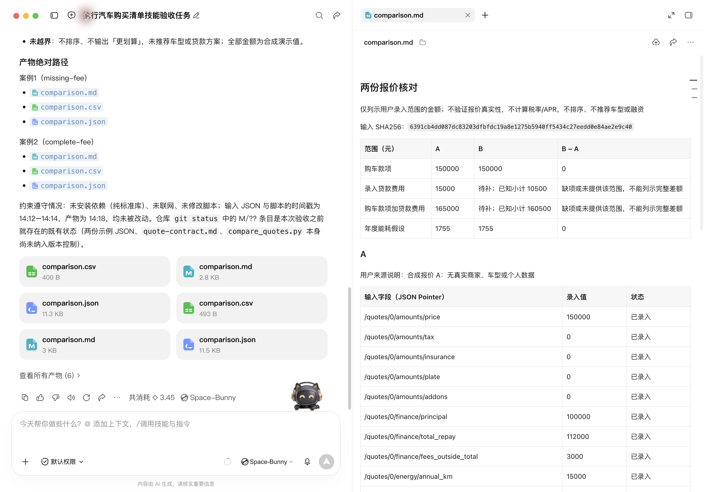

# WorkBuddy 实测：两份报价，缺项不能填成零

作者：Captain。实测日期：2026-10-15。本文由 AI 辅助整理，使用全部公开的合成输入，记录维护者侧的客户端验收。

两份报价，A 的总还款额 112000，B 是 110500。如果只减掉相同的本金，B 看起来少了 1500。但 B 没有填写总还款额之外的费用，这个差额还不能当完整贷款费用比较。把未知费用按零处理，会让表格看起来完整，却丢掉最需要核对的问题。

这次给 WorkBuddy 的任务很小：使用我维护的「买车」技能，把同一组报价分别跑一次“费用缺项”和“费用补齐”，交付能看懂、能用表格打开、也能按字段核验的三份文件。

## 客户端实际做了什么

维护者的 Codex 代理操作真实 **WorkBuddy 5.8.2** 客户端，界面标注模型为 **Space-Bunny**。任务于 14:17 启动，先显式读取本地仓库的 `SKILL.md` 与[输入契约](../../skills/car-buying-checklist/references/quote-contract.md)，再运行两次本地脚本；两次退出码均为 0。没有联网查价格，也没有自动读取真实报价单。



*原始客户端截图，界面展示任务与生成结果。执行主体是维护者侧 AI 代理；截图没有证明独立用户使用、市场自动发现或任何省时、省钱结果。*

这次使用的是本地 `car-buying-checklist` v0.1.2。SkillHub 发布包已上传，扫描与线上交付读取仍需单独核对；本地客户端跑通不自动等同于市场发布完成。

## 第一轮：已知 10500，不等于完整费用 10500

所有数值都是合成演示输入，不对应真实车型、商家或地区报价。

| 项目（元） | A | B：第一轮 |
|---|---|---|
| 贷款本金 | 100000 | 100000 |
| 总还款额 | 112000 | 110500 |
| 未含在总还款额里的另收费用 | 3000 | 未知，输入为 null |
| 已知还款差额 | 12000 | 10500 |
| 录入范围贷款费用 | 15000 | null，待补 |

计算式是：`总还款额 − 本金 + 另收费用`。A 的三项都已提供，得到 15000。B 只能计算还款差额 10500；另收费用未知，完整录入范围费用就仍然未知。

客户端生成的 JSON 保留了这种区别：

```json
{
  "complete": false,
  "value": null,
  "known_subtotal": "10500",
  "missing_fields": ["/quotes/1/finance/fees_outside_total"]
}
```

这是[第一次实际输出](../../examples/car-quotes/outputs/missing-fee/comparison.json)中 B 的贷款费用字段摘录。Markdown 明确标注待补，CSV 的完整费用单元格留空并保留 `complete=false`。比较结果为 `comparable=false`，完整费用差额也是 null。三种文件表达同一个意思：已知部分可以列，缺项不能补成零。

## 第二轮：只补一个字段，再看差额

第二份输入只把 B 的另收费用从 null 补为 6000，其他数字沿用同一组合成数据。重新运行后：

| 录入范围贷款费用（元） | A | B：补齐后 |
|---|---|---|
| 计算式 | 112000 − 100000 + 3000 | 110500 − 100000 + 6000 |
| 结果 | 15000 | 16500 |
| 完整性 | true | true |
| B − A | — | 1500 |

这时才可以列示这一范围的完整差额。它不是「选 A 更划算」的判断：期限、付款时间、提前还款条款与资金安排都没有进入计算，不计算 APR，也不推荐融资产品。

购车款项与年度能耗另列。样例中的税费、保险等零值均是明确给定的合成数字，没有按政策推算。两个能源假设都算出 1755：A 使用家充/快充加权单价，B 使用统一单价；它们没有被混进贷款费用。

## 文件交付之后，再核对一次

两轮各留下 `comparison.md`、`comparison.csv`、`comparison.json`，共六份实际客户端产物。原始文件已[逐字公开](../../examples/car-quotes/README.md)，两份输入也一并保留。

根代理随后从相同输入独立重跑，六份结果均逐字一致；核对了输入 SHA256 与原 11 份技能源码，原件没有改变。[核验记录](../../examples/car-quotes/verification.json)保留文件哈希、字节数、输入路径及各项结论。

这份记录支持的是：维护者侧 AI 通过真实 WorkBuddy 客户端，显式读取本地技能并完成了这两个合成任务；确定性脚本产物可以独立复现。它没有证明真人独立试用、SkillHub 自动发现、真实业务采纳或重复使用。

本次升级也修复了三个相关输入问题：重复参数不再静默取最后一个值；统一单价不能与家充/快充模式混用；未填写另收费用不再被当作零。金额使用 Decimal，拒绝非有限数字、负数和超范围输入；税费与保险只按用户给定金额列示。两轮真实运行以外，这些边界由 48 项本地回归测试验证。

## 安装与复跑

已有 SkillHub CLI 时，可按[官方安装说明](https://skillhub.cn/install/skillhub.md)指定作者与 WorkBuddy 技能目录：

```bash
skillhub install car-buying-checklist --namespace indiv-captain --dir "$HOME/.workbuddy/skills"
```

以 CLI 实际输出为准核对安装位置、作者和版本；已有同名目录先检查，不直接强制覆盖。安装成功、客户端读取、本地任务通过、市场自动发现是需要分别核对的步骤。

本次可复现来源是[公开仓库技能](../../skills/car-buying-checklist/)。在仓库根目录运行下面两条命令，输出目录须是新名字：

```bash
mkdir -p out
python3 skills/car-buying-checklist/scripts/compare_quotes.py --input examples/car-quotes/inputs/two-quotes-missing-fee.json --out-dir out/car-quotes-missing
python3 skills/car-buying-checklist/scripts/compare_quotes.py --input examples/car-quotes/inputs/two-quotes-complete.json --out-dir out/car-quotes-complete
```

输入契约、两份 JSON、六份实际输出和一段[可直接复制给 WorkBuddy 的任务](../../examples/car-quotes/README.md#可复制给-workbuddy-的任务)都放在同一案例目录。Python 3 标准库即可运行，不需要接商家系统或提供个人数据。脚本拒绝覆盖已有输出目录，复跑请换新名字。

如果你实际试用了，可以在[项目反馈入口](https://github.com/po-et/workbuddy-skills/issues/new/choose)留下版本、合成或已脱敏输入，以及期望与实际结果。我们当前更需要知道的是：你能否在自己的环境完成任务、哪里卡住、是否还会再次使用。维护者验收不计入独立用户使用记录。
