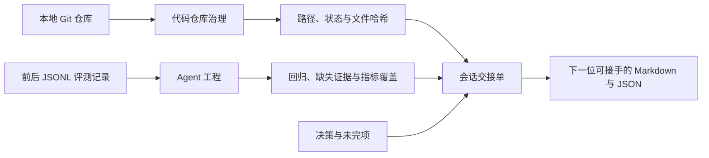

# 接手仓库 → 改进 Agent → 换会话继续

三个可以离线运行的工程技能。依赖 Python 3.9+；仓库盘点另需 Git。不依赖模型 API Key 或其他技能安装。先用合成记录体验输出，再替换为你有权使用的本地材料。



| 你遇到的问题 | 技能与版本 | 交付 |
|---|---|---|
| 接手陌生仓库，不知道文档、测试和构建入口在哪里 | [代码仓库治理](https://skillhub.cn/skills/@indiv-captain/repo-governance-pro) v0.1.3 | HEAD、工作区状态、跟踪路径、文件哈希；Markdown + JSON |
| 改提示词后不知道是否有回归 | [Agent 工程](https://skillhub.cn/skills/@indiv-captain/agent-engineering-expert) v0.1.2 | 成对通过变化、回归案例、缺失证据、耗时成本覆盖；Markdown + JSON |
| 会话太长，换模型后容易丢进度 | [会话交接单](https://skillhub.cn/skills/@indiv-captain/handoff-doc-zh) v0.1.2 | 目标、决策、未完项、下一步、文件哈希、验证记录问题；Markdown + JSON |

## 安装与第一条任务

```bash
skillhub install repo-governance-pro --namespace indiv-captain --dir "$HOME/.workbuddy/skills"
skillhub install agent-engineering-expert --namespace indiv-captain --dir "$HOME/.workbuddy/skills"
skillhub install handoff-doc-zh --namespace indiv-captain --dir "$HOME/.workbuddy/skills"
```

安装目录依据 [SkillHub 官方安装指引](https://skillhub.cn/install/skillhub.md)。已有同名目录时先核对作者、版本与本地改动，不直接覆盖。以 CLI 返回的实际安装位置为准，按官方说明重启 WorkBuddy，再在任务中显式指定技能。

可以复制下面一条任务，并补上自己的路径：

> 使用“代码仓库治理”盘点这个本地仓库：`/path/to/project`。把报告放到仓库之外的新目录，不执行项目代码。先看采集是否一致，再告诉我文档、测试、构建和 CI 有哪些可核对的入口。

> 使用“Agent 工程”比较我提供的 before.jsonl 与 after.jsonl。列出回归、新增通过、缺失案例与证据；耗时和成本缺项保留未知。不要因为配对结果更好就声称所有业务都改善。

> 使用“会话交接单”整理当前任务，保持真实的进行中状态。引用已有文件，写清未完项、下一步和验收条件。验证没跑就记 not_run，把交接包放到系统临时目录，并给我两份文件的绝对路径。

## 不通过时怎么继续

仓库盘点的退出 `0` 表示报告生成，不能证明测试通过。先看证据截断、脏文件和采集中变化。

评测对比的退出 `1` 仍会生成报告：它可能发现回归，也可能发现记录不完整。根据具体案例修正或补证据，再复跑；不要改判据来隐藏回归。成本口径由记录来源提供。

交接生成的退出 `1` 表示记录需要复核；缺文件、哈希冲突、缺验证时间或证据均保留。它不会执行记录中的命令，也不能替调用者证明任务完成。

合成示例与维护者测试不代表第三方使用或新版本在 WorkBuddy 客户端已验收。[反馈一次真实任务](https://github.com/po-et/workbuddy-skills/issues/new?template=skill-feedback.md)时注明版本、输入类型、实际输出和是否愿意复用；避免提交敏感原件。

脚本与输入契约：[仓库盘点](../skills/repo-governance-pro/)、[评测对比](../skills/agent-engineering-expert/)、[交接生成](../ported/skills/handoff-doc-zh/)。交接正文改编自 [Matt Pocock handoff](https://github.com/mattpocock/skills/blob/main/skills/productivity/handoff/SKILL.md)，保留 MIT 署名与完整许可；其余两项工具由本项目原创增强。
