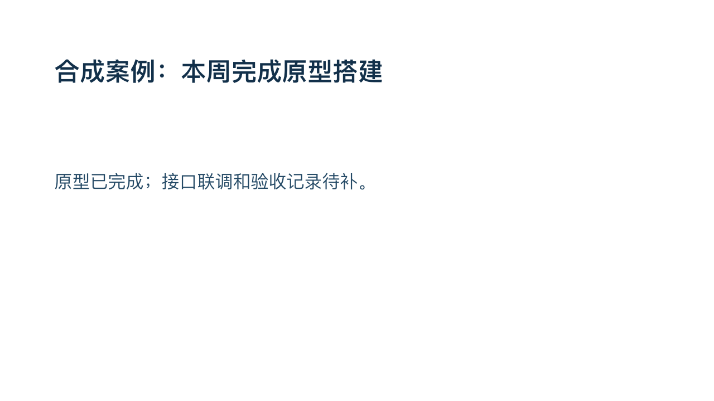
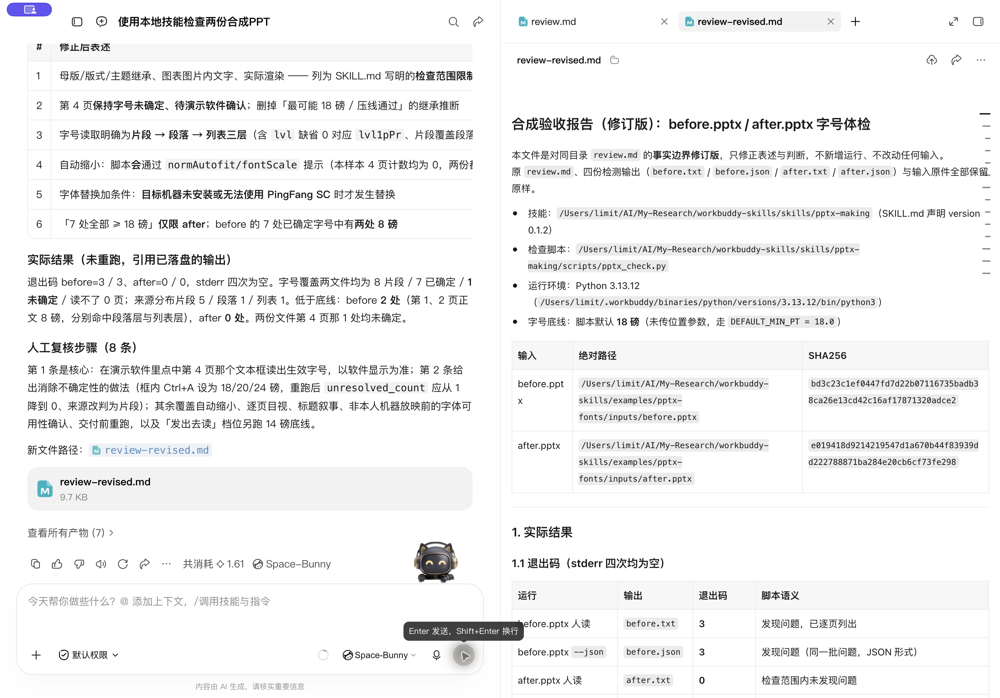

# WorkBuddy 实测：8 磅正文为什么没报错

2026-10-21，维护者的 Codex 代理操作真实 **WorkBuddy 5.8.2 / Space-Bunny**，显式读取本地 `pptx-making` 0.1.2 并执行两份公开合成 PPT。四份脚本标准输出已由根代理独立重跑，逐字节一致。执行主体是维护者侧 AI，不是独立用户试用，也没有验证市场自动发现。

这项技能检查已有 PPT，不生成 PPTX。两份四页输入由维护者使用 ArtifactTool 制作，再在页内 XML 中设置测试字号；没有使用真实工作报告或客户数据。两份文件均通过包结构检查、ArtifactTool 导入和逐页渲染；**尚未完成 PowerPoint GUI 打开与视觉验收**。下方图片是 ArtifactTool 渲染，不能当作 PowerPoint 截图。

SkillHub 的 `indiv-captain/pptx-making` **0.1.2 已公开上线**，两项扫描均为 benign；维护者一次验收下载的 5 份发布文件与上传副本哈希一致。[线上读回](../../docs/metrics/pptx-release-verified-2026-10-21.json)记录查询时间、版本和验包结果。新版 AI 评测仍未确认，旧评测不计作本次升级结果；验包下载不计独立用户。

## 输入、实际结果与未覆盖项

| 页 | 正文的字号设置位置 | [原件](inputs/before.pptx) | [修正版](inputs/after.pptx) |
|---|---|---|---|
| 1 | 当前段落默认字号 | 8 磅，新版发现 | 24 磅 |
| 2 | 当前文本体第 2 级列表样式，段落 `lvl=1` | 8 磅，新版发现 | 24 磅 |
| 3 | 片段明确 24 磅，覆盖段落默认 8 磅 | 24 磅，不误报 | 24 磅，不误报 |
| 4 | 三层页内设置都没有字号 | 未确定 `null` | 未确定 `null` |

默认底线为 18 磅。旧版 0.1.1 对原件退出 **0**，显示“没发现问题”；新版对原件的人读 / JSON 两次运行均退出 **3**，对修正版两次均退出 **0**。两份都有 8 处非空文字片段，7 处已确定、1 处未确定。修正版的 `status=no_issues_in_checked_scope`，不是整份 PPT 合格。

两个 ZIP 包只有 `ppt/slides/slide1.xml`、`slide2.xml` 内容不同，每个部件仅一处 `sz="800"` 改成 `sz="2400"`，其他部件逐字节相同。第 3、4 页保持不变，用来检查覆盖优先级和未知项是否保留。




字号按片段 `rPr` → 同段落 `pPr/defRPr` → 当前文本体对应列表层级读取。段落默认属性的作用见 [Microsoft DrawingML 说明](https://learn.microsoft.com/en-us/dotnet/api/documentformat.openxml.drawing.defaultrunproperties?view=openxml-3.0.1)，列表层级见 [Level1ParagraphProperties](https://learn.microsoft.com/en-us/dotnet/api/documentformat.openxml.drawing.level1paragraphproperties?view=openxml-3.0.1)。本检查器只实现这里明确列出的页内范围，不解析母版、版式、主题继承；不检查图片和独立图表部件内的文字，也不计算最终渲染字号、字体替换、重叠或裁切。`normAutofit/fontScale` 会单列提示。

## 原始产物与独立复跑

- [原件的人读结果](outputs/before.txt) / [JSON](outputs/before.json)
- [修正版的人读结果](outputs/after.txt) / [JSON](outputs/after.json)
- [客户端退出码记录](outputs/exit-codes.txt)
- [经反馈校订的客户端说明](outputs/review-revised.md) / [根代理补充边界](outputs/review-notes.md)
- [核验记录](verification.json)：输入、技能源文件与四份输出哈希，以及证据边界



根代理在原始 stdout 上独立核对退出码、来源哈希、两处 8 磅定位、片段覆盖优先级、`8/7/1` 覆盖数和原件不变。客户端初稿把部分明确不覆盖的能力说成“技能声称的能力”，并对未知字号作了多余推断；复核后让客户端另存校订说明，四份检测输出保持不变。AI 说明与确定性脚本结果需要分别核对。

在仓库根目录执行（Python 3 标准库；只读，不安装依赖）：

```bash
python3 -B examples/pptx-fonts/verify_case.py
```

也可直接运行检查器，结果输出到终端：

```bash
python3 -B skills/pptx-making/scripts/pptx_check.py examples/pptx-fonts/inputs/before.pptx --json
# 预期退出 3：发现两处偏小文字
python3 -B skills/pptx-making/scripts/pptx_check.py examples/pptx-fonts/inputs/after.pptx --json
# 预期退出 0：检查范围内未发现问题，但仍有 1 处字号未确定
```

21 项行为测试与独立的 20 次 CLI 探针、14 份 JSON 检查覆盖字段文字、空片段、字号优先级、表格文本体、未知项和 NaN/Inf 拒绝。这些数量是各自验证层的执行数，不合并成独立用例总数，也不证明实际投影效果。

## 交给 WorkBuddy 的任务

先打开本仓库，安装时指定作者与目录（已有 SkillHub CLI；核对实际版本，保留已有文件）：

```bash
skillhub install pptx-making --namespace indiv-captain --dir "$HOME/.workbuddy/skills"
```

技能包提供检查器；这里的四页 PPT 与完整案例属于 GitHub 仓库。实际安装版本以平台返回为准，源码可直接复跑。

> 先读本仓库 skills/pptx-making/SKILL.md。实际检查 examples/pptx-fonts/inputs/before.pptx 与 after.pptx，用技能自带脚本的默认底线，分别交付人读输出和 --json 报告；保存到一个全新目录，已有目录就停止。记录真实退出码、原件 SHA256、已确定与未确定字号数、小字号的页码与来源，另写 review.md 给出逐页复核建议。未知字号不能写成通过，不猜最终继承字号。保留原件、脚本、记忆与配置，不安装依赖、不联网；无法启动就报告实际错误，不手写假结果。

最后在自己的演示软件中逐页查看，尤其确认第 4 页正文的实际字号、字体可用性和视觉效果。若实际使用，可在[反馈入口](https://github.com/po-et/workbuddy-skills/issues/new?template=skill-feedback.md)附版本、公开或脱敏输入、期望与实际结果，以及是否愿意再次使用。
